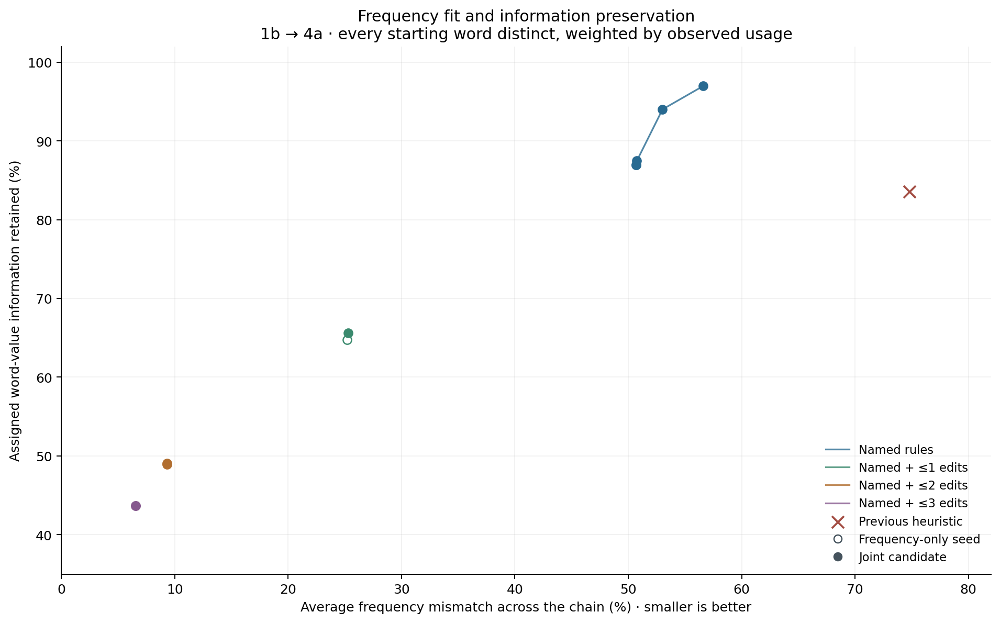

# Echo7: jointly optimizing frequency mass and information

15 October 2026.

**Completed optimization sweep and independent replay audit.**

The new model optimizes both criteria across the complete chain. It replaces greedy destination selection and uniform splitting with fitted, source-blind transition probabilities. Every initial spelling has a distinct value; observed starting token frequencies determine the prior.

## Objective and constraints

`objective = mean section frequency mismatch + λ × final fractional information loss`.

Frequency mismatch is total variation distance between the propagated whole-section word rates and observed section rates. Zero is an exact fit. Every later section enters equally. Information loss is H(original spelling | current spelling) / H(original spelling). Neither quantity is decoded semantic information.

One routing vector applies to each current spelling at each transition. Once values merge, subsequent routing cannot distinguish their ancestry. Both retention and changes may be selected; no mandatory identity allocation and no automatic independent residual mixing is used. Unattested persistence remains explicit and incurs frequency mismatch.

Named edges use the scheduled candidate graph, including tentative rules, with observed nonidentity destinations. They are support permissions, not historical probability estimates. Different words can select different operations; shared family-wide application is not imposed. The generic controls add atomic one-, two-, or three-edit candidates with observed adjacent-section rates within a factor of two and targets unclaimed by the saved named-only allocation. Generic eligibility uses the original observed rates, not the fitted rates. These are missing-rule hypotheses, not evidence for those edits.

A full-chain flow linear program finds the global minimum average frequency mismatch on each support. The information-aware objective is nonconvex. The named sweep uses continuation from the frequency-optimal solution through increasing information weights, plus a separate near-identity start at every weight. Each generic control starts from its frequency-optimal solution and from near-identity. The lower actual joint objective is retained, including the exact feasible frequency seed; candidate channels are never averaged. Named searches use at most 220 iterations per start; generic searches use at most 160. If smoothing produces a candidate slightly worse under actual total variation, the better exact seed is kept and this is reported. Reported iteration-limit statuses are retained. These are achieved candidates, not certified maximum-information mappings or a complete Pareto frontier.

Routing probabilities use a separate softmax for each current spelling and stage, with logits bounded to [−25,25]. L-BFGS-B uses an analytic gradient back-propagated through the entire chain. During search only, absolute frequency differences are smoothed as sqrt(delta² + 10⁻¹⁴) − 10⁻⁷. Every reported mismatch and candidate-selection objective uses the actual unsmoothed total variation. Initial priors never change. Structural graph isolation is reduced out of the computation, but all isolated starting labels, their information, and their frequency mismatches remain in the totals.

## Primary 1b results

| Allowed routes | Objective setting | Mean frequency mismatch | Final mismatch | All-word information retained | Common-word information retained | Initial-hapax information retained | Final weight on attested words |
|---|---|---:|---:|---:|---:|---:|---:|
| Named rules | Best frequency fit (λ=0) | 50.71% | 51.37% | 86.94% | 77.01% | 98.87% | 66.27% |
| Named rules | Keep every spelling | 73.07% | 77.59% | 100.00% | 100.00% | 100.00% | 57.32% |
| Named rules | Frequency emphasis (λ=0.05) | 50.71% | 51.37% | 86.96% | 77.05% | 98.87% | 66.30% |
| Named rules | Moderate information penalty (λ=0.2) | 50.76% | 51.43% | 87.47% | 78.19% | 98.89% | 66.26% |
| Named rules | Stronger information penalty (λ=0.75) | 53.02% | 53.36% | 94.00% | 91.99% | 99.24% | 65.83% |
| Named rules | Strongest information penalty (λ=3) | 56.60% | 57.19% | 96.96% | 98.30% | 99.44% | 65.09% |
| Named + ≤1 edits | Best frequency fit (λ=0) | 25.19% | 17.30% | 64.75% | 60.75% | 80.97% | 87.14% |
| Named + ≤1 edits | Joint optimization (λ=0.2) | 25.30% | 17.53% | 65.62% | 62.25% | 81.29% | 87.23% |
| Named + ≤2 edits | Best frequency fit (λ=0) | 9.33% | 3.15% | 48.92% | 44.79% | 59.08% | 97.33% |
| Named + ≤2 edits | Joint optimization (λ=0.2) | 9.34% | 3.17% | 49.03% | 44.98% | 59.15% | 97.34% |
| Named + ≤3 edits | Best frequency fit (λ=0) | 6.55% | 1.52% | 43.67% | 36.85% | 53.16% | 98.48% |
| Named + ≤3 edits | Frequency seed retained after joint search (λ=0.2) | 6.55% | 1.52% | 43.67% | 36.85% | 53.16% | 98.48% |

The previous 1b heuristic had 74.81% mean frequency mismatch and retained 83.53% of the same all-word ID information. These comparisons use the same initial corpus and token prior.

Common-word and initial-hapax retention condition on their respective starting cohorts; they are not the all-word score. The complete data also reports uncertainty of common labels when all other source values are potential competitors. High information on unattested spellings is not verified historical survival; read attestation and frequency mismatch alongside every information score.

## Every section and starting-point sensitivity

| Start | Routes | Setting | Section | Frequency mismatch | All-word information retained | Common-word information retained |
|---|---|---|---|---:|---:|---:|
| 1a | Named rules | Best frequency fit | 1a | 0.00% | 100.00% | 100.00% |
| 1a | Named rules | Best frequency fit | 1b | 45.23% | 96.28% | 93.80% |
| 1a | Named rules | Best frequency fit | 1.5a | 50.45% | 95.06% | 92.09% |
| 1a | Named rules | Best frequency fit | 2a | 48.78% | 92.69% | 87.65% |
| 1a | Named rules | Best frequency fit | 3a | 52.92% | 90.68% | 84.20% |
| 1a | Named rules | Best frequency fit | 3b | 54.57% | 89.60% | 82.30% |
| 1a | Named rules | Best frequency fit | 3c | 54.72% | 88.40% | 80.16% |
| 1a | Named rules | Best frequency fit | 4c | 53.16% | 86.34% | 76.66% |
| 1a | Named rules | Best frequency fit | 4a | 52.86% | 85.04% | 73.66% |
| 1a | Named rules | Keep every spelling | 1a | 0.00% | 100.00% | 100.00% |
| 1a | Named rules | Keep every spelling | 1b | 51.10% | 100.00% | 100.00% |
| 1a | Named rules | Keep every spelling | 1.5a | 59.18% | 100.00% | 100.00% |
| 1a | Named rules | Keep every spelling | 2a | 64.65% | 100.00% | 100.00% |
| 1a | Named rules | Keep every spelling | 3a | 74.19% | 100.00% | 100.00% |
| 1a | Named rules | Keep every spelling | 3b | 75.88% | 100.00% | 100.00% |
| 1a | Named rules | Keep every spelling | 3c | 73.08% | 100.00% | 100.00% |
| 1a | Named rules | Keep every spelling | 4c | 77.87% | 100.00% | 100.00% |
| 1a | Named rules | Keep every spelling | 4a | 76.88% | 100.00% | 100.00% |
| 1a | Named rules | Frequency emphasis | 1a | 0.00% | 100.00% | 100.00% |
| 1a | Named rules | Frequency emphasis | 1b | 45.24% | 96.34% | 93.84% |
| 1a | Named rules | Frequency emphasis | 1.5a | 50.39% | 95.11% | 92.10% |
| 1a | Named rules | Frequency emphasis | 2a | 48.81% | 92.73% | 87.64% |
| 1a | Named rules | Frequency emphasis | 3a | 52.87% | 90.73% | 84.26% |
| 1a | Named rules | Frequency emphasis | 3b | 54.56% | 89.64% | 82.33% |
| 1a | Named rules | Frequency emphasis | 3c | 54.73% | 88.48% | 80.29% |
| 1a | Named rules | Frequency emphasis | 4c | 53.17% | 86.39% | 76.74% |
| 1a | Named rules | Frequency emphasis | 4a | 52.93% | 85.12% | 73.84% |
| 1a | Named rules | Moderate information penalty | 1a | 0.00% | 100.00% | 100.00% |
| 1a | Named rules | Moderate information penalty | 1b | 45.38% | 96.77% | 94.32% |
| 1a | Named rules | Moderate information penalty | 1.5a | 50.46% | 95.62% | 92.69% |
| 1a | Named rules | Moderate information penalty | 2a | 48.92% | 93.36% | 88.46% |
| 1a | Named rules | Moderate information penalty | 3a | 52.98% | 91.52% | 85.41% |
| 1a | Named rules | Moderate information penalty | 3b | 54.63% | 90.45% | 83.53% |
| 1a | Named rules | Moderate information penalty | 3c | 54.79% | 89.40% | 81.85% |
| 1a | Named rules | Moderate information penalty | 4c | 53.22% | 87.43% | 78.44% |
| 1a | Named rules | Moderate information penalty | 4a | 53.09% | 86.39% | 76.16% |
| 1a | Named rules | Stronger information penalty | 1a | 0.00% | 100.00% | 100.00% |
| 1a | Named rules | Stronger information penalty | 1b | 47.90% | 98.32% | 98.91% |
| 1a | Named rules | Stronger information penalty | 1.5a | 54.14% | 97.71% | 98.18% |
| 1a | Named rules | Stronger information penalty | 2a | 51.23% | 96.45% | 96.15% |
| 1a | Named rules | Stronger information penalty | 3a | 53.93% | 95.81% | 95.37% |
| 1a | Named rules | Stronger information penalty | 3b | 57.04% | 95.24% | 94.50% |
| 1a | Named rules | Stronger information penalty | 3c | 56.67% | 94.86% | 94.23% |
| 1a | Named rules | Stronger information penalty | 4c | 56.42% | 94.14% | 93.35% |
| 1a | Named rules | Stronger information penalty | 4a | 57.11% | 93.94% | 93.06% |
| 1a | Named rules | Strongest information penalty | 1a | 0.00% | 100.00% | 100.00% |
| 1a | Named rules | Strongest information penalty | 1b | 50.72% | 100.00% | 100.00% |
| 1a | Named rules | Strongest information penalty | 1.5a | 58.51% | 100.00% | 100.00% |
| 1a | Named rules | Strongest information penalty | 2a | 63.59% | 100.00% | 100.00% |
| 1a | Named rules | Strongest information penalty | 3a | 71.74% | 100.00% | 100.00% |
| 1a | Named rules | Strongest information penalty | 3b | 72.40% | 100.00% | 100.00% |
| 1a | Named rules | Strongest information penalty | 3c | 70.02% | 100.00% | 100.00% |
| 1a | Named rules | Strongest information penalty | 4c | 73.81% | 100.00% | 100.00% |
| 1a | Named rules | Strongest information penalty | 4a | 73.10% | 100.00% | 100.00% |
| 1b | Named rules | Best frequency fit | 1b | 0.00% | 100.00% | 100.00% |
| 1b | Named rules | Best frequency fit | 1.5a | 53.88% | 97.93% | 95.69% |
| 1b | Named rules | Best frequency fit | 2a | 50.22% | 95.99% | 93.20% |
| 1b | Named rules | Best frequency fit | 3a | 49.05% | 93.57% | 88.75% |
| 1b | Named rules | Best frequency fit | 3b | 49.23% | 91.66% | 86.01% |
| 1b | Named rules | Best frequency fit | 3c | 51.10% | 90.54% | 83.74% |
| 1b | Named rules | Best frequency fit | 4c | 50.12% | 88.22% | 79.61% |
| 1b | Named rules | Best frequency fit | 4a | 51.37% | 86.94% | 77.01% |
| 1b | Named rules | Keep every spelling | 1b | 0.00% | 100.00% | 100.00% |
| 1b | Named rules | Keep every spelling | 1.5a | 60.57% | 100.00% | 100.00% |
| 1b | Named rules | Keep every spelling | 2a | 67.66% | 100.00% | 100.00% |
| 1b | Named rules | Keep every spelling | 3a | 71.69% | 100.00% | 100.00% |
| 1b | Named rules | Keep every spelling | 3b | 75.80% | 100.00% | 100.00% |
| 1b | Named rules | Keep every spelling | 3c | 76.31% | 100.00% | 100.00% |
| 1b | Named rules | Keep every spelling | 4c | 81.88% | 100.00% | 100.00% |
| 1b | Named rules | Keep every spelling | 4a | 77.59% | 100.00% | 100.00% |
| 1b | Named rules | Frequency emphasis | 1b | 0.00% | 100.00% | 100.00% |
| 1b | Named rules | Frequency emphasis | 1.5a | 53.88% | 97.94% | 95.73% |
| 1b | Named rules | Frequency emphasis | 2a | 50.21% | 96.00% | 93.24% |
| 1b | Named rules | Frequency emphasis | 3a | 49.04% | 93.56% | 88.76% |
| 1b | Named rules | Frequency emphasis | 3b | 49.23% | 91.66% | 86.01% |
| 1b | Named rules | Frequency emphasis | 3c | 51.12% | 90.54% | 83.75% |
| 1b | Named rules | Frequency emphasis | 4c | 50.12% | 88.22% | 79.64% |
| 1b | Named rules | Frequency emphasis | 4a | 51.37% | 86.96% | 77.05% |
| 1b | Named rules | Moderate information penalty | 1b | 0.00% | 100.00% | 100.00% |
| 1b | Named rules | Moderate information penalty | 1.5a | 53.87% | 97.99% | 95.79% |
| 1b | Named rules | Moderate information penalty | 2a | 50.22% | 96.10% | 93.37% |
| 1b | Named rules | Moderate information penalty | 3a | 49.03% | 93.69% | 88.92% |
| 1b | Named rules | Moderate information penalty | 3b | 49.33% | 91.85% | 86.27% |
| 1b | Named rules | Moderate information penalty | 3c | 51.31% | 90.82% | 84.15% |
| 1b | Named rules | Moderate information penalty | 4c | 50.10% | 88.58% | 80.33% |
| 1b | Named rules | Moderate information penalty | 4a | 51.43% | 87.47% | 78.19% |
| 1b | Named rules | Stronger information penalty | 1b | 0.00% | 100.00% | 100.00% |
| 1b | Named rules | Stronger information penalty | 1.5a | 55.00% | 98.87% | 98.45% |
| 1b | Named rules | Stronger information penalty | 2a | 52.22% | 97.77% | 97.46% |
| 1b | Named rules | Stronger information penalty | 3a | 51.68% | 96.61% | 95.41% |
| 1b | Named rules | Stronger information penalty | 3b | 51.85% | 95.74% | 94.61% |
| 1b | Named rules | Stronger information penalty | 3c | 53.62% | 95.29% | 93.63% |
| 1b | Named rules | Stronger information penalty | 4c | 53.41% | 94.33% | 92.61% |
| 1b | Named rules | Stronger information penalty | 4a | 53.36% | 94.00% | 91.99% |
| 1b | Named rules | Strongest information penalty | 1b | 0.00% | 100.00% | 100.00% |
| 1b | Named rules | Strongest information penalty | 1.5a | 56.85% | 99.23% | 99.70% |
| 1b | Named rules | Strongest information penalty | 2a | 54.75% | 98.57% | 99.69% |
| 1b | Named rules | Strongest information penalty | 3a | 55.60% | 97.94% | 98.72% |
| 1b | Named rules | Strongest information penalty | 3b | 56.16% | 97.64% | 98.58% |
| 1b | Named rules | Strongest information penalty | 3c | 58.02% | 97.61% | 98.57% |
| 1b | Named rules | Strongest information penalty | 4c | 57.62% | 97.09% | 98.31% |
| 1b | Named rules | Strongest information penalty | 4a | 57.19% | 96.96% | 98.30% |
| 1b | Named + ≤1 edits | Best frequency fit | 1b | 0.00% | 100.00% | 100.00% |
| 1b | Named + ≤1 edits | Best frequency fit | 1.5a | 31.68% | 94.33% | 93.85% |
| 1b | Named + ≤1 edits | Best frequency fit | 2a | 25.03% | 89.78% | 88.69% |
| 1b | Named + ≤1 edits | Best frequency fit | 3a | 22.74% | 84.17% | 83.48% |
| 1b | Named + ≤1 edits | Best frequency fit | 3b | 26.06% | 79.46% | 78.09% |
| 1b | Named + ≤1 edits | Best frequency fit | 3c | 32.61% | 74.92% | 72.88% |
| 1b | Named + ≤1 edits | Best frequency fit | 4c | 20.87% | 69.05% | 65.14% |
| 1b | Named + ≤1 edits | Best frequency fit | 4a | 17.30% | 64.75% | 60.75% |
| 1b | Named + ≤1 edits | Joint optimization | 1b | 0.00% | 100.00% | 100.00% |
| 1b | Named + ≤1 edits | Joint optimization | 1.5a | 31.74% | 94.42% | 93.99% |
| 1b | Named + ≤1 edits | Joint optimization | 2a | 25.20% | 89.96% | 88.98% |
| 1b | Named + ≤1 edits | Joint optimization | 3a | 22.84% | 84.42% | 83.83% |
| 1b | Named + ≤1 edits | Joint optimization | 3b | 26.15% | 79.82% | 78.50% |
| 1b | Named + ≤1 edits | Joint optimization | 3c | 32.74% | 75.43% | 73.58% |
| 1b | Named + ≤1 edits | Joint optimization | 4c | 20.90% | 69.67% | 66.05% |
| 1b | Named + ≤1 edits | Joint optimization | 4a | 17.53% | 65.62% | 62.25% |
| 1b | Named + ≤2 edits | Best frequency fit | 1b | 0.00% | 100.00% | 100.00% |
| 1b | Named + ≤2 edits | Best frequency fit | 1.5a | 7.96% | 93.26% | 93.11% |
| 1b | Named + ≤2 edits | Best frequency fit | 2a | 6.30% | 86.33% | 84.98% |
| 1b | Named + ≤2 edits | Best frequency fit | 3a | 8.35% | 77.87% | 76.20% |
| 1b | Named + ≤2 edits | Best frequency fit | 3b | 10.36% | 70.76% | 69.32% |
| 1b | Named + ≤2 edits | Best frequency fit | 3c | 24.45% | 64.12% | 62.14% |
| 1b | Named + ≤2 edits | Best frequency fit | 4c | 4.71% | 56.65% | 53.50% |
| 1b | Named + ≤2 edits | Best frequency fit | 4a | 3.15% | 48.92% | 44.79% |
| 1b | Named + ≤2 edits | Joint optimization | 1b | 0.00% | 100.00% | 100.00% |
| 1b | Named + ≤2 edits | Joint optimization | 1.5a | 7.98% | 93.27% | 93.11% |
| 1b | Named + ≤2 edits | Joint optimization | 2a | 6.32% | 86.36% | 85.01% |
| 1b | Named + ≤2 edits | Joint optimization | 3a | 8.36% | 77.90% | 76.25% |
| 1b | Named + ≤2 edits | Joint optimization | 3b | 10.38% | 70.82% | 69.41% |
| 1b | Named + ≤2 edits | Joint optimization | 3c | 24.46% | 64.18% | 62.21% |
| 1b | Named + ≤2 edits | Joint optimization | 4c | 4.73% | 56.74% | 53.65% |
| 1b | Named + ≤2 edits | Joint optimization | 4a | 3.17% | 49.03% | 44.98% |
| 1b | Named + ≤3 edits | Best frequency fit | 1b | 0.00% | 100.00% | 100.00% |
| 1b | Named + ≤3 edits | Best frequency fit | 1.5a | 4.19% | 92.62% | 91.69% |
| 1b | Named + ≤3 edits | Best frequency fit | 2a | 2.79% | 85.42% | 81.81% |
| 1b | Named + ≤3 edits | Best frequency fit | 3a | 5.25% | 76.27% | 73.57% |
| 1b | Named + ≤3 edits | Best frequency fit | 3b | 7.82% | 68.63% | 65.12% |
| 1b | Named + ≤3 edits | Best frequency fit | 3c | 22.26% | 59.72% | 56.19% |
| 1b | Named + ≤3 edits | Best frequency fit | 4c | 2.00% | 51.65% | 46.26% |
| 1b | Named + ≤3 edits | Best frequency fit | 4a | 1.52% | 43.67% | 36.85% |
| 1b | Named + ≤3 edits | Frequency seed retained after joint search | 1b | 0.00% | 100.00% | 100.00% |
| 1b | Named + ≤3 edits | Frequency seed retained after joint search | 1.5a | 4.19% | 92.62% | 91.69% |
| 1b | Named + ≤3 edits | Frequency seed retained after joint search | 2a | 2.79% | 85.42% | 81.81% |
| 1b | Named + ≤3 edits | Frequency seed retained after joint search | 3a | 5.25% | 76.27% | 73.57% |
| 1b | Named + ≤3 edits | Frequency seed retained after joint search | 3b | 7.82% | 68.63% | 65.12% |
| 1b | Named + ≤3 edits | Frequency seed retained after joint search | 3c | 22.26% | 59.72% | 56.19% |
| 1b | Named + ≤3 edits | Frequency seed retained after joint search | 4c | 2.00% | 51.65% | 46.26% |
| 1b | Named + ≤3 edits | Frequency seed retained after joint search | 4a | 1.52% | 43.67% | 36.85% |

## Inspect individual words

The app now includes a searchable word explorer at `index.html#word-explorer`, covering all 6,903 spellings and all 18 saved fitted models and controls. The first table compares observed counts and normalized section rates with complete projected spelling rates and starting-value mixtures. The second follows an initial word value through every section, showing its six largest destination branches and the remaining weight. A spelling absent at the start has no separately assigned source value, but its later usage and incoming values remain inspectable. Selecting a word replays saved probabilities without refitting. Negligible projected usage is labeled explicitly rather than presenting tiny numerical residuals as substantial mixtures.

Browser calculations were checked against an independent Python replay: 165 word/section forward-value and backward-origin comparisons, plus 150 whole-mass section checks across all 18 conditions; maximum discrepancy 1.72e-15. Verification metrics are retained in `joint_word_explorer_verification.json`. The temporary dense reference fixture is removed after verification; `export_joint_word_explorer.py` can regenerate it.

## Numerical verification and optimizer status

Independent replay without optimizer imports checks every saved kernel, allowed edge, row probability, source prior, complete stage trajectory, direct-KL information, common/hapax score and the data-processing inequality. It also verifies every exported word rate, observed count, endpoint and source contribution. Maximum discrepancy: 5.15e-14. A directional finite-difference check of the whole-chain analytic gradient had maximum error 1.16e-12.

The endpoint export was corrected to include identity-only labels reduced out of the optimizer. Those labels were already included in all scores and section rates; this repair changes destination listings, not frequencies, information scores or fitted kernels.

Storage validation on 15 October passed: workspace 17.09 GiB, no completed-study arrays of 10 MB or more. Dense model arrays were temporary RAM data; verified sparse kernels, reports and compact endpoint data are retained.

| Start | Routes | Setting | Selected iterations | Solver termination |
|---|---|---|---:|---|
| 1a | Named rules | Best frequency fit | 6260 | Optimization terminated successfully. (HiGHS Status 7: Optimal) |
| 1a | Named rules | Keep every spelling | — | Identity control |
| 1a | Named rules | Frequency emphasis | 220 | STOP: TOTAL NO. of ITERATIONS REACHED LIMIT |
| 1a | Named rules | Moderate information penalty | 220 | STOP: TOTAL NO. of ITERATIONS REACHED LIMIT |
| 1a | Named rules | Stronger information penalty | 220 | STOP: TOTAL NO. of ITERATIONS REACHED LIMIT |
| 1a | Named rules | Strongest information penalty | 220 | STOP: TOTAL NO. of ITERATIONS REACHED LIMIT |
| 1b | Named rules | Best frequency fit | 4812 | Optimization terminated successfully. (HiGHS Status 7: Optimal) |
| 1b | Named rules | Keep every spelling | — | Identity control |
| 1b | Named rules | Frequency emphasis | 220 | STOP: TOTAL NO. of ITERATIONS REACHED LIMIT |
| 1b | Named rules | Moderate information penalty | 220 | STOP: TOTAL NO. of ITERATIONS REACHED LIMIT |
| 1b | Named rules | Stronger information penalty | 220 | STOP: TOTAL NO. of ITERATIONS REACHED LIMIT |
| 1b | Named rules | Strongest information penalty | 220 | STOP: TOTAL NO. of ITERATIONS REACHED LIMIT |
| 1b | Named + ≤1 edits | Best frequency fit | — | Identity control |
| 1b | Named + ≤1 edits | Joint optimization | 160 | STOP: TOTAL NO. of ITERATIONS REACHED LIMIT |
| 1b | Named + ≤2 edits | Best frequency fit | — | Identity control |
| 1b | Named + ≤2 edits | Joint optimization | 160 | STOP: TOTAL NO. of ITERATIONS REACHED LIMIT |
| 1b | Named + ≤3 edits | Best frequency fit | — | Identity control |
| 1b | Named + ≤3 edits | Frequency seed retained after joint search | 0 | Exact feasible frequency seed retained: neither bounded joint search improved its actual unsmoothed objective. |

## Where the illustrated optimized solution loses distinctions

The named λ=0.75 solution loses 0.513403 bits in total. The exact destination ledger sums to every step within 4.73e-15 bits. All destinations are saved in `joint_loss_trace.json`; the largest two per transition are shown in the app. A destination is charged only for new ambiguity, after subtracting ambiguity already present in its incoming mixtures.

The frequency-only LP is an optimistic support benchmark. Residual mismatch can reflect missing transformations, actual changes in usage, segmentation, or failure of this fixed-prior model. The joint scores cannot establish that these routes were used historically or that meanings changed. No named rule, Golf ordering, or linguistic interpretation is promoted by this test.

A separate entropy ceiling is deliberately distinguished from achieved results: the 1b source entropy is 8.563508 bits; the lowest later observed word entropy is 8.524459 bits in 4a. Under exact empirical marginals and the fixed source prior, data processing therefore gives an information ceiling of 99.544%. This upper bound does not construct such a system. It also means that substantially lower achieved scores cannot be attributed to the output entropy alone; route constraints and local allocation choices still matter.

Source: `joint_optimization.py`, `joint_generic_optimization.py`; actual-objective selection: `finalize_joint_candidates.py`; verification: `verify_joint_optimization.py`; destination ledger: `joint_loss_trace.py`. Reproduce the named sweep for both `--start 1a` and `--start 1b` with `--iterations 220 --seeds 2 --weights 0.05,0.2,0.75,3`; run generic `--ed 1`, `--ed 2`, and `--ed 3` with `--start 1b --iterations 160 --seeds 2 --weight 0.2`. Then run the finalizer, independent verifier over all five result files, loss ledger, and report. Full kernels and endpoint source contributions are retained in the corresponding compact JSON files. No dense arrays are retained.
